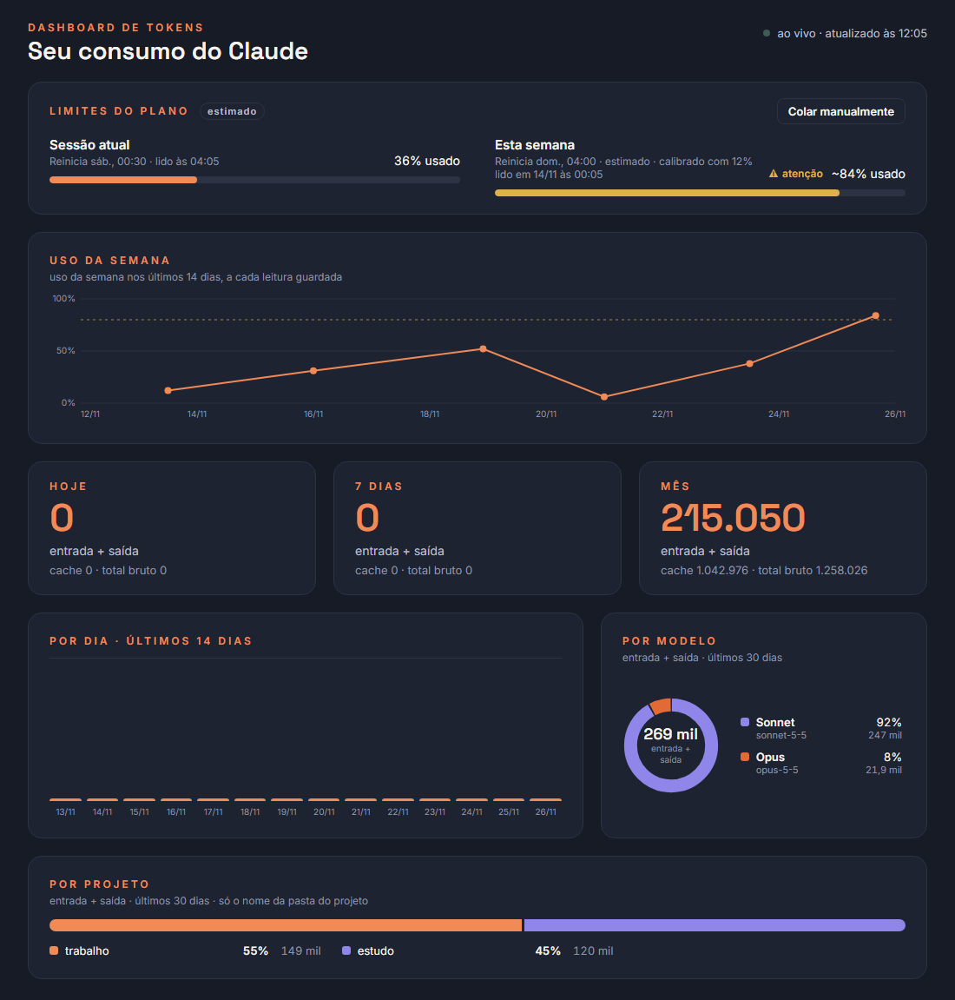

# Dashboard de Tokens (tokenEye)

Aplicativo desktop que mostra **ao vivo o seu consumo de tokens do Claude**, lendo os logs locais do Claude Code.
Feito com Electron e HTML, CSS e JavaScript puros (sem framework e sem etapa de build). **Só metadados de uso são lidos**: o conteúdo das conversas nunca é acessado, guardado ou exibido.

## Tecnologias

- **Aplicativo:** Electron (Windows), HTML, CSS e JavaScript puros, gráficos em SVG feitos à mão
- **Leitura de dados:** `~/.claude/projects/**/*.jsonl` (só tokens, modelo, horário, pasta do projeto e id da sessão), observador de pastas com `chokidar` e varredura de segurança a cada minuto
- **Segurança:** `contextIsolation`, `sandbox`, `nodeIntegration: false`, CSP sem scripts inline, sem rede, sem telemetria
- **Testes:** `node:test`, com logs e limites 100% fictícios em `fixtures/`

## Tela

Captura feita com dados 100% fictícios (`npm run screenshot`).



| Cartão | O que mostra |
| --- | --- |
| **Limites do plano** | Barras da sessão de 5 h e da semana, com alerta amarelo (80%) e vermelho (95%) |
| **Uso da semana** | Gráfico de linha, responsivo, com as leituras guardadas dos últimos 14 dias |
| **Hoje · 7 dias · Mês** | Entrada + saída, com o cache e o total bruto no detalhe |
| **Por dia** | Barras dos últimos 14 dias |
| **Por modelo** | Rosca por família (Opus, Sonnet, Haiku), últimos 30 dias |
| **Por projeto** | Barra empilhada e lista dos maiores projetos, últimos 30 dias (só o nome da pasta) |

## Como rodar

Requisito: **Node.js 22 ou superior**.

```bash
npm install
npm start
```

| Script | O que faz |
| --- | --- |
| `npm start` | Abre a janela do app |
| `npm test` | Roda os testes automatizados |
| `npm run smoke` | Abre o app, confere que carregou sem erro e fecha sozinho |
| `npm run screenshot` | Gera um PNG com dados fictícios em `docs/screenshots/` |
| `npm run prova-leitura` | Soma os tokens de hoje direto dos logs, para conferência independente |

> **Se `npm start` falhar com `Cannot read properties of undefined (reading 'disableHardwareAcceleration')`:** o terminal tem a variável `ELECTRON_RUN_AS_NODE` definida, e ela faz o Electron rodar como Node puro. Remova-a antes (PowerShell: `Remove-Item Env:ELECTRON_RUN_AS_NODE`).

## Limites do plano (sessão de 5 h e semana)

A leitura é **automática**, em duas camadas, e a colagem manual é só reserva.

### 1. Percentual oficial, pela linha de status do Claude Code

O Claude Code recebe da Anthropic os percentuais de uso da assinatura e os entrega ao script da linha de status (campo `rate_limits`). O `scripts/statusline.js` pega **só** esses números, grava em `%APPDATA%\dashboard-tokens\limites-auto.json` e mostra `sessão 36% · semana 66%` no Claude Code. O app observa o arquivo e atualiza as barras sozinho (selo "automático"). O app continua sem rede e sem ler credenciais.

Para ativar em qualquer pasta, adicione ao seu `~/.claude/settings.json`, trocando o caminho pelo da pasta do projeto (com barras `/`):

```json
"statusLine": {
  "type": "command",
  "command": "node \"C:/caminho/para/dashboard-tokens/scripts/statusline.js\""
}
```

Limitações: só roda onde o Claude Code exibe a linha de status (terminal), vale para sessões iniciadas depois da configuração e os números só se renovam enquanto você usa o Claude Code. Para diagnosticar, veja `%APPDATA%\dashboard-tokens\statusline-ultima-chamada.json` (guarda só os nomes dos campos recebidos, nunca os valores).

### 2. Estimativa pelos logs, quando o oficial não chega

Para a barra não ficar parada numa leitura antiga, o app **estima** o valor da janela de agora:

1. Das leituras guardadas, escolhe a mais recente com pelo menos 10% e calcula a **taxa**: quantos % cada token (entrada + saída) valeu naquela janela.
2. Multiplica a taxa pelos tokens dos logs na janela atual: o bloco de 5 h em andamento (sessão) e a semana corrente.
3. Mostra o número com "~", o selo "estimado" e "calibrado com 61% lido em 13/11". Uma leitura oficial ou colada depois substitui a estimativa.

Limitações: não enxerga o uso no claude.ai nem os pesos exatos de cada modelo, e sem nenhuma leitura de pelo menos 10% o app não inventa número.

### 3. Colagem manual (reserva)

Clique em **Colar manualmente** e cole o texto de **Configurações → Uso** do claude.ai. Se o texto não for reconhecido, o app abre campos para preencher à mão. As leituras ficam em `limites.json`, com histórico.

### Alerta

Amarelo a partir de 80% e vermelho a partir de 95%, com ícone e texto. Para mudar, edite `"alerta": { "atencao": 80, "critico": 95 }` em `%APPDATA%\dashboard-tokens\limites.json`.

## Privacidade e segurança

- Lê somente `~/.claude/projects/**/*.jsonl` e somente metadados de uso. O projeto aparece só pelo **nome da última pasta**, nunca pelo caminho completo.
- Nunca lê `.credentials.json`, `settings.json`, `history.jsonl` ou qualquer arquivo de credenciais.
- Sem rede, sem telemetria, sem CDN: fontes e bibliotecas são locais.
- Eventos de erro são capturados e registrados no console, sem derrubar o app; se a pasta de logs não puder ser lida, a tela mostra um estado de erro claro.
- Os testes usam só dados fictícios (`fixtures/`).

## Estrutura

```
src/
  main/             processo principal: leitura de logs, agregação, limites, estimativa, janela
  renderer/         interface em HTML, CSS e JavaScript puros (gráficos em SVG)
fixtures/           logs e limites fictícios usados nos testes
test/               testes automatizados (node:test)
scripts/            smoke test, captura de tela, prova de leitura e linha de status
docs/screenshots/   captura de tela com dados fictícios
```

## Licença

[MIT](LICENSE)
